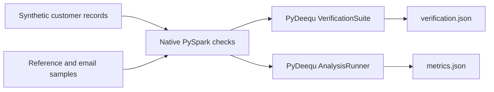

# Customer Data Quality Validation Pipeline

**Mupembe Tshisekedi · [GitHub](https://github.com/Rems2014)**

A reproducible PySpark and PyDeequ project that detects missing ages, duplicate customer IDs, invalid values, inconsistent emails, and stale records. Docker packages the runtime; JSON reports make audit results reviewable.

**[Download the portfolio submission PDF](docs/Customer_Data_Quality_Portfolio_Submission.pdf)**

## Submission summary

I built a containerized customer-data validation workflow using native PySpark transformations and PyDeequ constraint verification. A demonstrated four-record run detected repeated customer IDs and ages of -5 and 150, and produced saved audit and profiling reports.

## Problem and scope

Unreliable customer data can distort analytics. This project demonstrates how to expose quality problems before adding automated enforcement. It uses embedded synthetic datasets, not production customer data.

**Implemented:** six quality dimensions, dataset-level verification, profiling, Docker setup, saved reports, report-contract checks, and a CI workflow.

**Planned:** API and database ingestion, Airflow scheduling, explicit ingestion schemas, Bronze/Silver storage, quarantine routing, and publication gates. No production error reduction or performance speedup is claimed.

## Architecture



Spark runs in local[2] mode inside one Docker container. This is a local demonstration, not a measured distributed deployment.

## Run in Windows PowerShell

Start Docker Desktop with Linux containers enabled. Clone this portfolio repository, then run:

```powershell
git clone https://github.com/Rems2014/rems2014.github.io.git
cd rems2014.github.io/projects/data-quality
docker compose run --build --rm data-quality
```

If already cloned, open `projects/data-quality` and run only the Docker command. The first build requires internet access for the image, Java, Python packages, and Deequ Maven dependencies.

### Review results

```powershell
Invoke-Item .\reports
python -s -m unittest discover -s tests -v
```

The report checks need only Python's standard library. Expected failed data constraints do not produce a nonzero application exit code. Unexpected runtime failures do. CI checks expected sample-report contents after execution.

## Demonstrated results

[Verification output](examples/verification.json) · [Profiling output](examples/metrics.json)

These files are preserved from the successful local Docker run on 20 October 2026. They are baseline evidence, not fabricated CI results.

| Check / metric | Observed result | Interpretation |
|---|---:|---|
| Dataset size | 4 | Four sample customer records |
| Age completeness | 0.75 | Passes the 75% threshold |
| Customer ID uniqueness | 0.5 | Fails the unique-ID requirement |
| Minimum age | -5 | Fails age >= 0 |
| Maximum age | 150 | Fails age <= 120 |
| Mean non-null age | 56.67 | Null age excluded |

Uniqueness 0.5 means two of four rows have identifiers occurring exactly once. ID 2 appears twice: one repeated ID and one excess record beyond the three distinct IDs.

## Quality dimensions

| Dimension | Demonstration |
|---|---|
| Completeness | Count missing ages; require at least 75% completeness |
| Uniqueness | Group repeated IDs; verify customer_id is unique |
| Validity | Inspect negative ages and ages above 120; audit min/max bounds |
| Accuracy | Compare postal codes against matching reference IDs |
| Consistency | Compare emails for matching customer IDs |
| Timeliness | Flag records older than 30 days at execution time |

Reference comparisons use inner joins: missing reference IDs and null postal codes are not fully covered. Timeliness changes with the run date. Dataset-level failures do not automatically quarantine rows.

## Engineering decisions

- Use native column expressions, joins, filters, and aggregations instead of Python row loops or UDFs. No benchmarked speedup is claimed.
- Pin packages and use Docker to avoid Windows user-package conflicts.
- Separate row-level inspection from dataset-level verification.
- Collect only small aggregate reports to the driver for JSON export.
- Stop Spark and close the PyDeequ callback server after execution.

## Files

```text
Data_quality.py          Sample data, checks, verification, profiling
Dockerfile               Python 3.11 / Java 17 runtime
compose.yaml             Build/run configuration and report mount
requirements.txt         Pinned Python dependencies
examples/                Saved evidence from the demonstrated run
reports/                 New outputs (ignored by Git)
tests/test_reports.py    Sample-report contract checks
docs/SUBMISSION.md       Submission text and reviewer walkthrough
```

The active portfolio CI workflow is at the repository root and runs this project directory. The project's nested workflow is a template for standalone use.

## Verification and limitations

The original Docker run produced the included baseline reports. The portfolio revision aligns age thresholds, makes report storage configurable, and adds callback cleanup. Syntax, baseline-report contracts, and Compose configuration passed locally. A fresh [GitHub Actions run](https://github.com/Rems2014/rems2014.github.io/actions/runs/39507885239) also passed: Docker build, complete sample execution, both generated-report checks, and report artifact upload.

No external ingestion, automated quarantine, production deployment, or large-scale benchmark is included. The base-image tag and Maven dependencies still depend on upstream availability.

## Next steps

1. Add API/database adapters with explicit schemas and malformed-record handling.
2. Persist Bronze input and define record-level rejection reasons.
3. Implement Silver/quarantine routing and duplicate resolution rules.
4. Add Airflow orchestration, alerts, and publication gates.
5. Measure runtime and resources on larger datasets.

## References

- [Spark 3.5.3](https://spark.apache.org/docs/3.5.3/)
- [PyDeequ](https://github.com/awslabs/python-deequ)
- [Deequ](https://github.com/awslabs/deequ)
